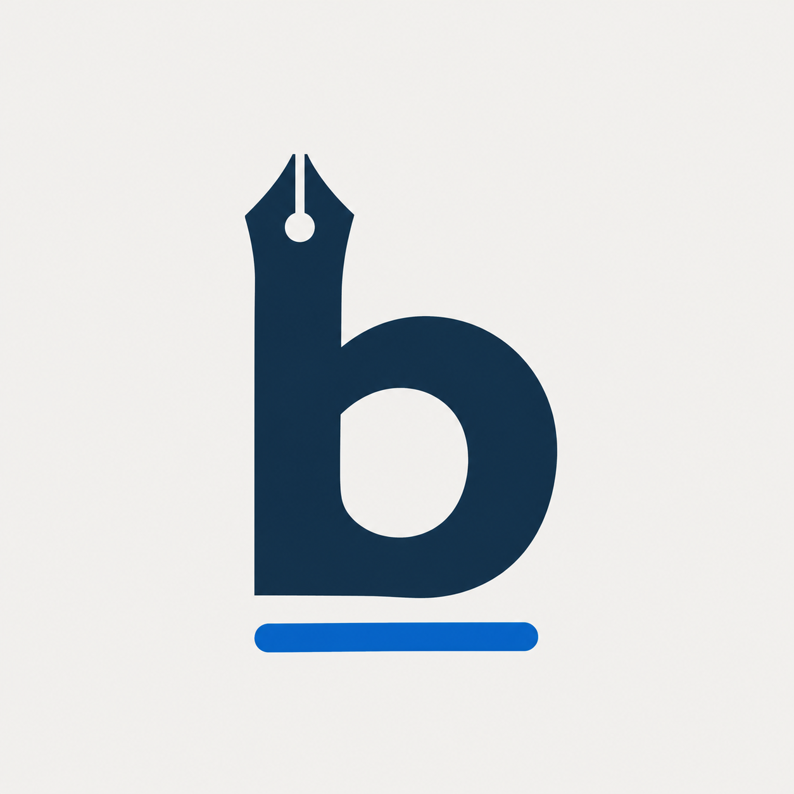

# ByLine identity



The lowercase **b** joins a fountain-pen nib to an editorial underline: your voice,
your byline. Deep ink navy, cobalt blue and warm ivory connect it to the app's
existing palette. The simple silhouette remains legible at launcher sizes.

`byline-logo.png` is the master artwork generated for ByLine on 7 November
2026. The application header loads this bundled asset; it needs no network request.
Android has legacy density icons and an adaptive icon. Windows has a multi-size
ICO, and the web shell has favicon and launcher assets.

To regenerate platform sizes from the master on Windows:

```powershell
powershell -NoProfile -ExecutionPolicy Bypass -File scripts/build-brand-assets.ps1
```

This script only resizes and packages the artwork. Preserve its aspect ratio and
clear space; do not stretch the mark or place important content outside the
Android adaptive mask. The PDF handbook was not changed for this release.
